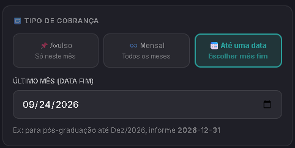
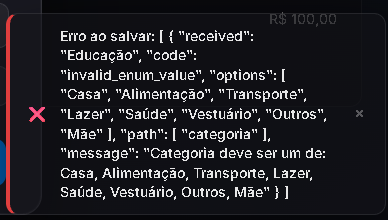

# Backlog de Correções e Melhorias

Execute as tarefas abaixo respeitando estritamente a ordem e o contexto fornecidos:

1. **Ajuste no Input de Vencimento (Gastos Fixos e Variáveis):**
   - Altere o campo de data de vencimento nos formulários de "Gastos Fixos" e "Gastos Variáveis".
   - O formato do input deve ser modificado para aceitar exclusivamente o **dia** do vencimento (ex: input numérico de 1 a 31), em vez de um seletor de data completa.

2. **Renomeação de Label de Pagamento:**
   - Localize o input rotulado atualmente como "CARTÃO/PESSOA" e renomeie sua label e placeholder para "FORMA DE PAGAMENTO".

3. **Formatação de Data em Recorrência:**
   - Ao selecionar o tipo de cobrança "Até uma data" (fim da recorrência), certifique-se de que a formatação da data exibida/inserida siga o padrão `DD/MM/AAAA`.
   

4. **Remoção de Campo de Subcategoria:**
   - Remova o input "Subcategoria" do formulário de criação/edição de Gastos Variáveis. Ajuste os estados e envios da API (payload) para refletir essa remoção sem quebrar a submissão.

5. **Remoção de Campo de Tags:**
   - Remova o input "TAGS" do formulário de criação/edição de Gastos Variáveis, seguindo o mesmo princípio de limpeza de interface e estados do item anterior.

6. **Correção de Bug (Adição de Gasto Variável):**
   - Identifique e corrija o erro de execução/renderização que está ocorrendo ao tentar adicionar um novo "Gasto Variável".
   

7. **Remoção de Campo em Receitas:**
   - Remova o campo "Pessoa" do formulário de adição/edição de Receitas.

8. **Refatoração da Lógica de Recorrência em Receitas:**
   - Remova o checkbox/input simples de "Recorrente" na adição de Receitas.
   - Aplique o **mesmo componente e padrão lógico** de recorrência usado nos Gastos Fixos.
   - A tela de receitas deve permitir escolher se o recebimento é: Avulso, Mensal (infinito) ou Recorrente até uma data limite.

9. **Nova Lógica de Arrecadação para "Metas":**
   - Implemente um mecanismo inteligente para Metas: o sistema deve calcular um valor de contribuição mensal necessário com base no valor total da meta e na data limite.
   - Quando ativado, o sistema deve registrar automaticamente um "Gasto Variável" correspondente a essa parcela, representando o dinheiro direcionado à meta.
   - Na interface, adicione um componente (caixinha/card) em cada Meta mostrando claramente o "Valor Arrecadado" e "Quanto Falta" para atingir o objetivo.

10. **Implementação de Novos Relatórios:**
    - Crie/formule novas visualizações na tela de Relatórios.
    - O foco deve ser fornecer: histórico consolidado do período, recursos para comparações entre meses/anos passados e projeções estatísticas/visuais para meses futuros.

11. **Melhorias Específicas na Tela de Investimentos:**
    - Adapte o formulário de investimentos para exibir campos dinâmicos baseados no tipo do ativo.
    - **Para Renda Fixa (ex: CDB):** Adicione um campo para informar a rentabilidade atrelada ao CDI (ex: "Quantos % do CDI?").
    - **Para Renda Variável (Ações, FIIs, etc.):** Inicie uma pesquisa/integração com APIs públicas ou gratuitas (ex: Brapi, HG Brasil, Yahoo Finance) capazes de buscar e atualizar automaticamente o valor das cotas em tempo real ou fechamento do dia.

12. **Alteração no Periodo:**
    - Atualize o sistema para que seja possivel visualizar apenas o ano atual, abrindo execessão apenas se o mes atual for dezembro ai sendo possivel visualizar